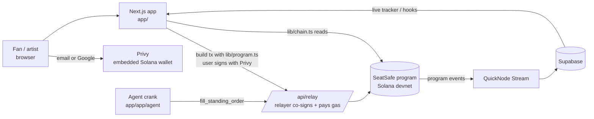

# SeatSafe

SeatSafe is a **ticketing platform** on Solana where fans can **buy and resell tickets without getting scammed or price-gouged**. Artists sell onchain tickets (Token-2022) with a resale price cap and royalty enforced in code. Fans resell through an atomic swap, so the ticket and the USDC change hands in one transaction. Tickets from outside platforms go through an escrow vault with deadlines and automatic refunds. **AI agents can fill standing orders** ("2 tickets under $90") from a capped budget vault, and a live tracker shows where the money and the ticket are at every moment. Users never see crypto: they log in with email or Google, see prices in dollars (devnet USDC), and a relayer pays gas.

- **Live app:** TODO(A): Vercel URL
- **Demo video:** TODO(C)
- Built for the UBC 2026 Hackathon. **Submission due Fri Nov 20, 12 PM CST.**

## 1. The problem

Fans buying resale tickets face two risks: **scams** (paying a stranger for a ticket that never arrives, or arrives fake) and **price gouging** (scalpers reselling far above face value, while the artist gets nothing from resale).

TODO(C): add 2–3 sourced numbers (scam losses, average resale markup), each with a link.

## 2. How it works

### Two trust tiers

| | Tier 1: SeatSafe tickets | Tier 2: outside tickets |
| --- | --- | --- |
| What | Tickets sold on SeatSafe (Token-2022, one mint per ticket) | Tickets from other platforms (Ticketmaster, AXS, …) |
| Resale | Atomic swap: ticket and USDC move in **one transaction** | Escrow: buyer's USDC waits in a program vault |
| Price | **Capped** by the artist (`price ≤ resale_cap`), enforced onchain | Set by the seller |
| Protection | Trustless: the swap either fully happens or doesn't | Trust-minimized: seller bond + deadlines + automatic refund + disputes |
| Artist | Earns a royalty on every resale | – |

### Money flow

| Flow | Buyer pays | Seller / organizer gets | Royalty | SeatSafe fee (3%) |
| --- | --- | --- | --- | --- |
| Primary sale | face price | organizer: price − fee | – | ✓ |
| Fan resale (swap) | listing price (≤ cap) | seller: price − royalty − fee | organizer | ✓ |
| Escrow completed | price | seller: price − fee, plus bond back | – | ✓ |
| Escrow refunded (seller missed the deadline) | gets back price + **seller's bond** | loses the bond | – | – |
| Dispute resolved / timed out | split by the arbiter / price back | rest / bond back | – | – |

Full table: [docs/program.md § Economics](docs/program.md#economics).

### Escrow states

```
                  fund_escrow            mark_sent             confirm_receipt / release_expired
 Listed ─────────────────────▶ Funded ─────────────▶ Sent ─────────────────────────────────────▶ Completed
   │                             │  │                  │
   │ cancel_escrow_listing       │  │ open_dispute     │ open_dispute
   ▼                             │  └───────┐  ┌───────┘
 Cancelled         refund_expired│          ▼  ▼
 (bond back)    (ship deadline   │        Disputed ──resolve_dispute / dispute_timeout──▶ Resolved
                 missed)         ▼
                             Refunded (price + bond to buyer)
```

In the app these map to the tracker's `HELD → IN_TRANSIT → RELEASED` (or `REFUNDED` / `DISPUTED`); see the table at the top of `app/lib/chain.ts`.

### After you buy

- **Add to calendar:** Google Calendar or an `.ics` file (Apple, Outlook) with a reminder 24 h before. Offered in the purchase toast, on every ticket in **My tickets**, and on the event page.
- **Can't go? Resell:** one tap from **My tickets**, prefilled at face value, capped by the artist.
- **Is this listing protected?** `/verify/<address>` checks any listing on the chain, with no login, before you pay.

## 3. Architecture



The six parts:

1. **Anchor program** (`program/`): tickets, capped resale, escrow, standing orders. 19 instructions, 24 tests. Reference: [docs/program.md](docs/program.md).
2. **Next.js app** (`app/`): event pages, My tickets, sell, creator, order tracker, agent console. Mock mode needs no keys.
3. **Login and wallets** (Privy): email or Google login creates an embedded Solana wallet. Users never hold SOL.
4. **Relayer** (`app/app/api/relay`): checks every transaction against `lib/relay-policy.ts` (SeatSafe instructions only, can't spend the relayer's SOL), co-signs as fee payer, sends and confirms.
5. **Indexing and data** (QuickNode Streams → Supabase): mirrors onchain events into the live tracker. Owner B.
6. **Agent and voice** (`app/app/agent`, ElevenLabs): standing orders filled by a crank from a capped budget vault, with voice approval. Owner D.

## 4. How we use Solana

- **Program:** `seatsafe`, Anchor, on devnet at [`7fnVUPd18tDr2CbEgjTxt55Emq4CMMskR9qxprjQjypy`](https://explorer.solana.com/address/7fnVUPd18tDr2CbEgjTxt55Emq4CMMskR9qxprjQjypy?cluster=devnet).
- **Token-2022 frozen tickets:** each ticket is its own mint (supply 1, decimals 0) with the **DefaultAccountState = Frozen** extension. Mint and freeze authority is the `["ticket_authority"]` PDA, so every ticket account starts frozen and only the program can thaw it. A holder can't transfer a ticket peer to peer; the only way to sell is `list_resale → swap_resale`, which enforces the cap. A plain `transferChecked` fails with "Account is frozen" (tested). See [docs/program.md § Plan B](docs/program.md#plan-b-ticket-design-why-the-cap-cant-be-bypassed).
- **Atomic swap with royalty and fee split:** `swap_resale` moves the ticket out of the listing vault and splits the buyer's USDC between seller, organizer royalty and treasury fee in one transaction.
- **Escrow vaults:** each `EscrowOrder` PDA owns a USDC account holding the buyer's payment plus the seller's bond. Deadlines use the cluster clock, so anyone can trigger `refund_expired` / `release_expired` after they pass. No admin can withdraw user funds.
- **Standing orders (agents):** a `StandingOrder` PDA owns a USDC budget vault. `fill_standing_order` checks event, max price, quantity, deadline and seller ≠ owner onchain, so a crank can only buy what the owner allowed.
- **Relayer as fee payer:** the relayer is the transaction fee payer and the `payer` for rent. Users sign only and hold **0 SOL** (proven on devnet: [docs/demo-checklist.md § 3](docs/demo-checklist.md#3-devnet-proof-2026-11-17-no-browser)).
- **USDC:** Circle devnet USDC, mint `4zMMC9srt5Ri5X14GAgXhaHii3GnPAEERYPJgZJDncDU`. All prices are USDC with 6 decimals, shown as dollars.

## 5. QuickNode Streams

TODO(B): fill in from the backend PR (#17, "Add the backend that mirrors the chain into the live tracker"), once merged:
- **Network:** Solana devnet
- **Dataset:** TODO(B)
- **Filter logic:** TODO(B), e.g. transactions that touch program `7fnVUPd1…`, decoded into SeatSafe events (`docs/program.md § Events`)
- **Destination:** TODO(B), e.g. a webhook into `app/api/…` that writes to Supabase
- **Why:** TODO(B)

## 6. ElevenLabs

TODO(D/C): `app/components/VoiceApproval.tsx` is the voice-approval UI for agent purchases ("incoming call"). The ElevenLabs integration (text-to-speech for the prompt, spoken yes/no) is still a `TODO(D)` in that file. Describe which ElevenLabs products are used and how once it's built.

## 7. Grok Bot on X

SeatSafe uses Grok to demonstrate how AI can support ticket listings and buyer education through X. In our demo, Grok generated a promotional post for a SeatSafe ticket listing and included a link to the marketplace. When asked whether the listing was legitimate, Grok explained how escrow can protect buyers by withholding payment until ticket delivery requirements are met. The conversation demonstrates how AI can help users understand ticket transaction risks and SeatSafe's proposed escrow protection.

Chat export: [docs/grok-chat-export.md](docs/grok-chat-export.md).

## 8. Economic design and risk assumptions

- **Fees:** 3% SeatSafe fee on primary sales, resales and completed escrows, read from the onchain `Config`. Artist royalty (set per event) on resales. `royalty + fee ≤ 50%` is enforced at `create_event`.
- **Resale cap** is enforced in `list_resale`, and because tickets are frozen outside the program there is no other way to sell a Tier 1 ticket. Off-chain side deals (cash, then a listing at the cap) can't be stopped by any onchain design.
- **Seller bond** (Tier 2) is lost to the buyer if the seller doesn't mark the ticket sent before the ship deadline.
- **Tier 2 is trust-minimized, not trustless:** the program can't see an outside ticket. The buyer is protected by the confirm window and disputes.
- **Arbiter** can only split a disputed escrow's own vault. If it never acts, `dispute_timeout` returns the price to the buyer and the bond to the seller.
- **No admin backdoor:** no instruction lets anyone withdraw user funds. The upgrade authority (deployer key) is the real trust root on devnet.
- **Crank trust:** the worst a malicious crank can do is fill a standing order with a listing that matches the owner's own rules. Seller ratings are off-chain, so `minSellerRating` is enforced by our crank only.

Full list: [docs/program.md § Trust and risk assumptions](docs/program.md#trust-and-risk-assumptions).

## 9. Deployed addresses (devnet)

| What | Address |
| --- | --- |
| SeatSafe program | [`7fnVUPd18tDr2CbEgjTxt55Emq4CMMskR9qxprjQjypy`](https://explorer.solana.com/address/7fnVUPd18tDr2CbEgjTxt55Emq4CMMskR9qxprjQjypy?cluster=devnet) (full program, upgraded Nov 16, 2026) |
| Config PDA | [`4fW9Z3ZkBHkCA4LubaWVox7Awu298oyLFhjQ7hi8XDry`](https://explorer.solana.com/address/4fW9Z3ZkBHkCA4LubaWVox7Awu298oyLFhjQ7hi8XDry?cluster=devnet) (fee 3%, dispute window 72 h) |
| Ticket authority PDA (mint + freeze authority) | `ECzfNYDLy1VBARppGPu86SAoWRV9LAsX9jpybdYn5LjR` |
| USDC mint (Circle devnet) | `4zMMC9srt5Ri5X14GAgXhaHii3GnPAEERYPJgZJDncDU` |
| Deployer, admin and treasury | `2VHBVmwU6C5NLdKjpykvJdGYWoSUw5uHAq3EKTbLHTqv` |
| Relayer | `7r2SszeUx3xyJsjAeUYvveMMmvkjjvxbPhxUGiP78g61` |
| Arbiter | `5AFvU5Cyxy6bUMbhumhmeJeRLbNxPjgr8bqKXENxnbjr` |
| Demo event: Battle of the Bands ($10, cap $15) | [`EMhrDn2puUvJac9PZ15CCTUftj2Axv6E7wp81oV1RzxE`](https://explorer.solana.com/address/EMhrDn2puUvJac9PZ15CCTUftj2Axv6E7wp81oV1RzxE?cluster=devnet) |
| Demo event: Neon Harbor ($75, cap $120) | `Hw1cWsKxef959oD338Qx86TjDt2km4XXRBqPgxjjvL7a` |
| Demo event: UT vs. A&M ($85, cap $130) | `6hW7X8JNFfwhU7Qx3dFTyy3LUa5tsCvMWyFhREdZZXzs` |

## 10. Setup

### Prerequisites

| Tool | Version used | Needed for |
| --- | --- | --- |
| Node.js | 20+ (built with 24.14.0) | app |
| npm | 11.9.0 | app |
| Rust | 1.100.0 (program pins 1.89.0 via `program/rust-toolchain.toml`) | program |
| Solana CLI (Agave) | 4.3.2 | program |
| Anchor CLI (via avm) | 1.2.2 | program |
| Surfpool | not needed | Anchor 1.x's default `anchor test` validator, but our tests use `solana-test-validator` via `npm test` (see below) |

Frontend-only teammates need **only Node 20+**. Solana tooling install guide: https://solana.com/docs/intro/installation

### Repo layout

```
program/     Anchor workspace (program: seatsafe)            owner A
  scripts/     init-devnet, seed-devnet, reset-demo
app/         Next.js app (App Router, TypeScript)
  app/         routes (see CONTRIBUTING.md for who owns which)
    api/         API routes                                     owner B (except /api/relay)
  components/  shared UI (components/ui = shadcn/ui)
  lib/         types.ts, program.ts (tx builders), tx.ts (relayer flow), chain.ts (readers), calendar.ts, …
    idl/         generated program IDL + TS types (copied by `npm run sync-idl`)
  scripts/     devnet / local verification scripts
supabase/    schema and seed                                  owner B
docs/        program reference, demo checklist
```

`app/lib/types.ts` is the contract the whole team codes against. UI gets data only through `useEvents()` / `useOrder()` in `app/lib/hooks.ts`.

### Run the app with mocks (no keys needed)

```bash
cd app
npm install
npm run dev        # http://localhost:3000
```

With no env vars the app uses mock data, login is disabled (a banner says so), and Supabase is `null`.

Try these pages:
- `/` Discover (event grid)
- `/orders/ord_held`, `/orders/ord_transit`, `/orders/ord_released` (order tracker with simulate buttons)
- `/agent`, `/tickets`, `/sell`, `/creator`, `/verify`
- `/api/health`

Other app scripts: `npm run lint`, `npm run build`.

### Run the app against devnet

Copy `app/.env.example` to `app/.env.local` and fill it in. Never commit `.env.local`.

| Variable | Default | Notes |
| --- | --- | --- |
| `NEXT_PUBLIC_USE_MOCK` | `true` | Set to `false` for devnet |
| `NEXT_PUBLIC_PRIVY_APP_ID` | empty | Empty means login disabled |
| `NEXT_PUBLIC_SOLANA_RPC_URL` | `https://api.devnet.solana.com` | Devnet RPC (a QuickNode devnet URL works too) |
| `NEXT_PUBLIC_USDC_MINT` | `4zMMC9srt5Ri5X14GAgXhaHii3GnPAEERYPJgZJDncDU` | Circle devnet USDC; verify at https://developers.circle.com |
| `NEXT_PUBLIC_PROGRAM_ID` | `7fnVUPd18tDr2CbEgjTxt55Emq4CMMskR9qxprjQjypy` | SeatSafe program ID (devnet) |
| `NEXT_PUBLIC_RELAYER_PUBKEY` | empty | `7r2SszeUx3xyJsjAeUYvveMMmvkjjvxbPhxUGiP78g61` |
| `RELAYER_SECRET_KEY` | empty | Server only: the relayer's **secret** key (contents of `.keys/relayer.json`), not its public address |
| `NEXT_PUBLIC_SUPABASE_URL` / `NEXT_PUBLIC_SUPABASE_ANON_KEY` | empty | From B |
| `SUPABASE_SERVICE_ROLE_KEY` | empty | Server only |

Then `npm run dev` and follow [docs/demo-checklist.md](docs/demo-checklist.md). `npm run demo:devnet` runs the buy / over-cap / resale / escrow-refund flows on devnet without a browser.

### Program: build, test, deploy

```bash
cd program
npm install                      # once, for the TypeScript tests
anchor build
npm test                         # = anchor test --validator legacy (uses solana-test-validator)
npm run sync-idl                 # copy target/idl + target/types into app/lib/idl/ after every build
```

**Run tests with `npm test` in `program/`; plain `anchor test` needs the legacy validator.** Anchor 1.x's `anchor test` starts Surfpool by default, and on this project the suite then fails before any test runs (`Blockhash not found` in the `before all` hook). Anchor.toml has no setting to change the default validator; Anchor reads it only from the `--validator` flag or the `ANCHOR_TEST_VALIDATOR` env var. If you want to type plain `anchor test`, either pass the flag (`anchor test --validator legacy`) or export `ANCHOR_TEST_VALIDATOR=legacy` in your shell first.

Deploy to devnet (deployer = `~/.config/solana/id.json`):

```bash
solana config set --url devnet
solana airdrop 2                 # or https://faucet.solana.com if rate limited
anchor deploy --provider.cluster devnet
```

`Anchor.toml` has the same program ID under `[programs.localnet]` and `[programs.devnet]`. After changing the program keypair, run `anchor keys sync`.

Keypairs live outside git: deployer in `~/.config/solana/id.json`, relayer and arbiter in `.keys/` at the repo root (git-ignored). Ask A for them; never commit or paste secret keys.

### Demo data

```bash
cd program
anchor run seed-devnet --provider.cluster devnet   # once: 3 events + seed seller tickets (idempotent)
anchor run reset-demo  --provider.cluster devnet   # before each demo: fresh $14 resale + $20 escrow listing
```

`reset-demo` needs 12 devnet USDC in the seed seller (`29ZQN6eHpp5VJH3zLSgC7UVUYsrb6czgrqEKb61LnzUs`); top up at https://faucet.circle.com. For a faster RPC, pass `--provider.cluster https://<your-devnet-endpoint>`.

## 11. Team and roles

| Member | Role | Owns |
| --- | --- | --- |
| A | Lead, Solana program, integration | `program/`, `app/lib/*`, `/events/[id]`, `/tickets`, `/sell`, `/creator`, `/verify`, `/api/relay` |
| B | Backend | `app/api/*` (except `/api/relay`), Supabase, QuickNode Streams, real data behind `lib/hooks.ts` |
| C | Pitch | Devpost page, demo video, pitch |
| D | Frontend and agent | Discover, order tracker, agent console, chat, voice approval (ElevenLabs), gate pass |

## Backend (Member B)

The API, Supabase schema, QuickNode stream, deadline cron, scam detector and standing-order matcher are documented in [docs/backend.md](docs/backend.md). Short version:

- Apply `supabase/schema.sql` and, for the mock-shaped data, `supabase/seed.sql`.
- `POST /api/stream-webhook` decodes Anchor logs for program `7fnVUPd18tDr2CbEgjTxt55Emq4CMMskR9qxprjQjypy` and moves orders forward only. Duplicate signatures are ignored.
- QuickNode: Solana **devnet**, dataset **Logs**, destination `https://<vercel-host>/api/stream-webhook`, header `x-webhook-secret`. The filter is in `docs/backend.md`. The stream is what makes the tracker move without a refresh.
- Vercel cron (`app/vercel.json`) calls `refund_expired` / `release_expired`, re-reads open escrows, and checks the relayer once a day, which is what the Hobby plan allows. Call those routes directly to run them during a demo.
- `POST /api/chat` flags off-app payment, links and pressure. `POST /api/standing-orders` turns one English sentence into `{ eventId, quantity, maxPrice, minRating, deadline }`. A match at or above $75 waits for `POST /api/standing-orders/:id/approve` (the voice card). Below that, the relayer sends `fill_standing_order`.

Set the Vercel project root to `app/`.

## Contributing
TODO(C): names and links for each member.

See [CONTRIBUTING.md](CONTRIBUTING.md) for branches, PRs, file ownership and deadlines.
