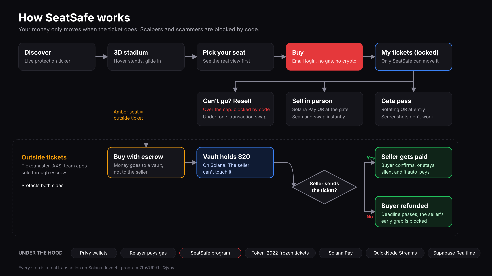
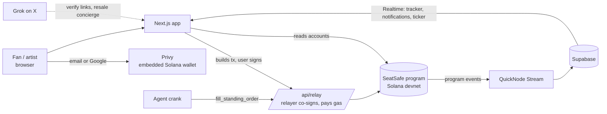
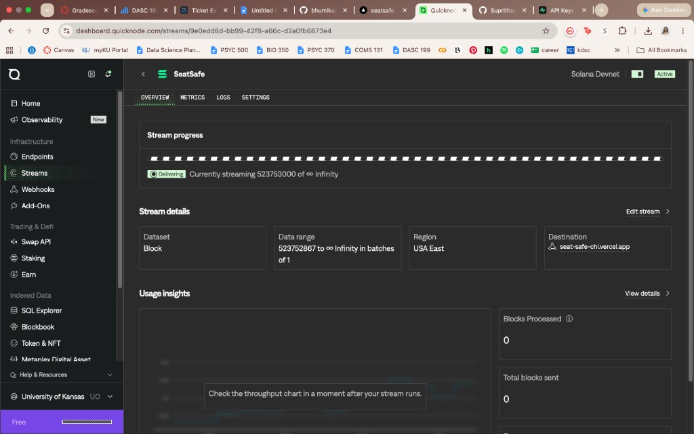

# SeatSafe

**Buy and resell tickets without getting scammed or price-gouged.** SeatSafe is a ticketing app on Solana where your money only moves when the ticket does. Artists sell onchain tickets with a resale price cap and royalty enforced in code. Fans resell through an atomic swap: the ticket and the payment change hands in one transaction. Tickets from other platforms (Ticketmaster, AXS) are sold through an escrow vault that refunds the buyer automatically if the seller never delivers. Fans never see crypto: they log in with email or Google, see prices in dollars, and pay no gas.

- **Live app:** https://seat-safe-chi.vercel.app
- **Demo video (3 min):** TODO(C): YouTube or Google Drive link
- **Live Lab:** [/simulator](https://seat-safe-chi.vercel.app/simulator): two people trade a ticket on Solana devnet, with every balance, padlock and transfer read from the chain and an "under the hood" view of each layer
- **Track:** Consumer Applications · **Chain award:** Best use of Solana · **Bounties:** QuickNode Streams, Grok Bot, ElevenLabs (TODO: keep only if voice approval is in the video)
- **Program (devnet):** [`7fnVUPd18tDr2CbEgjTxt55Emq4CMMskR9qxprjQjypy`](https://explorer.solana.com/address/7fnVUPd18tDr2CbEgjTxt55Emq4CMMskR9qxprjQjypy?cluster=devnet)




---

## 1. The problem

Buying a ticket from anyone but the box office is a leap of faith:

- UK ticket fraud losses are estimated at **£150M a year**, and **31% of 18–24-year-old gig-goers** say they've bought a fake ticket ([InterSpace / O2, 2026](https://interspacemusic.com/blog/?p=18860)).
- The average US concert-ticket scam reported to the BBB in 2025 cost **$303** ([Surfshark](https://surfshark.com/research/chart/concert-ticket-fraud)).
- At the **2026 World Cup**, fans who bought on major resale sites were left outside stadiums when tickets never transferred, and replacements cost two to three times more ([NPR](https://www.npr.org/2026/06/26/nx-s1-5871397/world-cup-tickets-stubhub-resale-controversy)).
- Even official resale is slow: FIFA's resale terms allow up to **60 days** to pay sellers, and takes a **15%** cut ([FootballTransfers](https://www.footballtransfers.com/us/transfer-news/world-fifa-club-world-cup/2026/05/fans-outraged-as-fifa-delays-paying-them-for-resold-world-cup-tickets)).

Underneath every story: buyers pay before they hold anything, platforms hold the money and the power, and deals move to DMs and payment apps where nothing protects anyone.

## 2. What SeatSafe does

| | What the fan sees |
| --- | --- |
| **3D stadium seat picker** | An aerial 3D stadium: hover a stand to see prices, glide in, pick a seat and see the real view from it before buying |
| **Buy** | Email or Google login, prices in dollars, no gas, no seed phrase |
| **My tickets** | Each ticket is locked: only SeatSafe can move it, so it can't be double-sold or sold above the cap |
| **Can't go? Resell** | One tap, prefilled at face value. Above the artist's cap: blocked by the program. At or below: ticket and money swap in one transaction, and the artist earns a royalty |
| **Sell in person** | At the gate, the seller shows a Solana Pay QR; the buyer scans it in the app and the swap happens instantly |
| **Outside tickets (escrow)** | The buyer's money goes into a vault on Solana, not to the seller. Seller delivers → seller gets paid. Seller doesn't → buyer is refunded automatically |
| **Live updates** | Order tracker, notifications ("your ticket sold", "your refund is back") and a live protection ticker on Discover, all pushed from onchain events |
| **Verify** | `/verify/<address>` checks any listing on Solana before you pay: "Protected SeatSafe listing" or "Don't pay" |
| **After you buy** | Add to calendar (Google or `.ics` with a reminder 24 h before), gate pass with rotating QR |
| **AI agents** | Standing orders ("2 tickets under $90") filled automatically from a capped budget vault, with approval before larger purchases |

## 3. How it works

### Two trust tiers

| | Tier 1: SeatSafe tickets | Tier 2: outside tickets |
| --- | --- | --- |
| What | Tickets issued on SeatSafe (Token-2022, one mint per ticket) | Tickets from Ticketmaster, AXS, team apps |
| Resale | **Atomic swap**: ticket and USDC move in one transaction | **Escrow**: the buyer's USDC waits in a program vault |
| Price | **Capped** by the artist, enforced onchain | Set by the seller |
| Protection | Trustless: the swap fully happens or not at all | Trust-minimized: deadlines, automatic refund, disputes |
| Artist | Royalty on every resale | none |

### Escrow protects both sides

- **Seller never sends the ticket:** after the ship deadline, anyone can trigger `refund_expired` and the buyer gets the money back. The seller can't withdraw early: the program rejects it.
- **Buyer goes silent after the ticket is sent:** after the confirm window, anyone can trigger `release_expired` and the seller is paid.
- **Disagreement:** either side opens a dispute; an arbiter can only split that order's own vault between buyer and seller. If the arbiter never acts, `dispute_timeout` refunds the buyer.

```
                  fund_escrow            mark_sent             confirm_receipt / release_expired
 Listed ─────────────────────▶ Funded ─────────────▶ Sent ─────────────────────────────────────▶ Completed
   │                             │  │                  │
   │ cancel_escrow_listing       │  │ open_dispute     │ open_dispute
   ▼                             │  └───────┐  ┌───────┘
 Cancelled         refund_expired│          ▼  ▼
                  (ship deadline │        Disputed ──resolve_dispute / dispute_timeout──▶ Resolved
                   missed)       ▼
                             Refunded (buyer gets the money back)
```

The program also supports an optional seller bond that goes to the buyer if the seller misses the deadline. TODO(A): state whether the app uses a bond ($0 or the amount).

### Money flow

| Flow | Buyer pays | Seller / organizer gets | Artist royalty | SeatSafe fee (3%) |
| --- | --- | --- | --- | --- |
| Primary sale | face price | organizer: price − fee | none | ✓ |
| Fan resale (swap) | listing price (≤ cap) | seller: price − royalty − fee | ✓ | ✓ |
| Escrow completed | price | seller: price − fee | none | ✓ |
| Escrow refunded | gets the price back | nothing | none | none |

Full economics: [docs/program.md § Economics](docs/program.md#economics).

## 4. Architecture



| Part | What it does | Where |
| --- | --- | --- |
| Anchor program | Tickets, capped resale, atomic swap, escrow, standing orders. 19 instructions, 24 tests | `program/` · [docs/program.md](docs/program.md) |
| Next.js app | 3D stadium, event pages, My tickets, sell, scan, verify, order tracker, agent console, Live Lab | `app/` |
| Login + wallets | Privy: email/Google login creates an embedded Solana wallet; users hold 0 SOL | `app/lib/privy.tsx` |
| Relayer | Checks every transaction against `lib/relay-policy.ts`, co-signs as fee payer, sends and confirms | `app/app/api/relay` |
| Indexing + realtime | QuickNode Stream → webhook → Supabase → Realtime to the UI | `app/app/api/stream-webhook`, `supabase/` · [docs/backend.md](docs/backend.md) |
| Agent | Plain English → standing order; crank fills matches within the budget vault | `app/app/agent`, `app/app/api/standing-orders` |

## 5. How we use Solana

- **Program:** `seatsafe` (Anchor), devnet [`7fnVUPd18tDr2CbEgjTxt55Emq4CMMskR9qxprjQjypy`](https://explorer.solana.com/address/7fnVUPd18tDr2CbEgjTxt55Emq4CMMskR9qxprjQjypy?cluster=devnet).
- **Token Extensions (Token-2022) frozen tickets:** each ticket is its own mint (supply 1, decimals 0) with **DefaultAccountState = Frozen**. Mint and freeze authority is the `["ticket_authority"]` PDA, so every ticket account starts frozen and only the program can thaw it. A holder can't transfer a ticket peer to peer; a plain `transferChecked` fails with "Account is frozen" (tested). The only way to sell is `list_resale → swap_resale`, which enforces the cap.
- **Atomic swap with royalty and fee split:** `swap_resale` moves the ticket and splits the buyer's USDC between seller, artist royalty and SeatSafe fee in one instruction.
- **Escrow vaults:** each `EscrowOrder` PDA owns the USDC vault for that order. Deadlines use the cluster clock; anyone can trigger `refund_expired` / `release_expired` after they pass. No instruction lets an admin withdraw user funds.
- **Standing orders:** a `StandingOrder` PDA owns a USDC budget vault; `fill_standing_order` checks event, max price, quantity, deadline and seller ≠ owner onchain.
- **Gasless for users:** the relayer is the fee payer and the rent payer; users sign only and hold 0 SOL (proven on devnet in [docs/demo-checklist.md](docs/demo-checklist.md)).
- **Solana Pay (in-person mode):** a **transaction request** endpoint (`/api/pay/swap`, GET label/icon, POST `{account}` → `{transaction, message}`, CORS) builds the same atomic `swap_resale` with the relayer as fee payer. The seller shows `solana:https://…/api/pay/swap?listing=<pda>` as a QR; the buyer scans it in the app (or any Solana Pay wallet on devnet) and adds the only missing signature. [Devnet proof](https://explorer.solana.com/tx/2rqbfipxdpvPQxxKx3MSTeDW6rA7dnSuBEshW7tK7YVwSmBAz54hBtar5ZP3cc6T9P4fQRh5grpKCcWho1H32dfN?cluster=devnet).
- **USDC:** Circle devnet USDC `4zMMC9srt5Ri5X14GAgXhaHii3GnPAEERYPJgZJDncDU`; prices shown in dollars.

## 6. QuickNode Streams

- **Network:** Solana devnet
- **Dataset:** Block
- **Filter:** a JavaScript `main(stream)` keeps a transaction only if its log lines mention program `7fnVUPd18tDr2CbEgjTxt55Emq4CMMskR9qxprjQjypy`, so the webhook receives only SeatSafe activity, not whole blocks. Code: [docs/backend.md](docs/backend.md).
- **Destination:** webhook `https://seat-safe-chi.vercel.app/api/stream-webhook`, authenticated with an `x-webhook-secret` header.
- **What happens on delivery:** the webhook decodes our Anchor events with the program IDL, updates orders, listings and tickets in Supabase (duplicate signatures ignored, orders only move forward), writes notifications, and Supabase Realtime pushes the change to open pages.
- **Why:** it's the core data source for everything live: the order tracker moves within about a second of a purchase, buyers and sellers get notifications ("your ticket sold", "your refund is back"), and the protection ticker on Discover updates ($ protected, scams auto-refunded, fair resales, scalpers blocked) without polling.



## 7. Grok Bot on X

Grok is SeatSafe's trust checker and concierge on X. Given a listing's onchain account data, Grok confirms whether it's controlled by the SeatSafe program (the seller can't take the money) or is a fake address ("do not send any money"), and explains it in plain English. It guides fans who can't attend through a safe, price-capped resale using a one-tap `/tickets?resell=<mint>` link, answers "just Venmo me" offers, and creates calendar links and reminders for events. Asked to trust our new website on its own, Grok refused, which is exactly the problem SeatSafe solves: proof has to come from the blockchain, not the site.

Chat export: [docs/grok-chat-export.md](docs/grok-chat-export.md).

## 8. Economic design and risk assumptions

- **Fees:** 3% on primary sales, resales and completed escrows (from the onchain `Config`). Artist royalty set per event; `royalty + fee ≤ 50%` enforced at `create_event`.
- **Resale cap** enforced in `list_resale`; because tickets are frozen outside the program, there's no other way to sell a Tier 1 ticket. Off-chain side deals can't be stopped by any onchain design.
- **Tier 2 is trust-minimized, not trustless:** the program can't see an outside ticket; buyers are protected by deadlines, automatic refunds and disputes.
- **Arbiter** can only split a disputed order's own vault; `dispute_timeout` refunds the buyer if it never acts.
- **No admin backdoor:** no instruction withdraws user funds. On devnet the upgrade authority (deployer key) is the trust root.
- **Relayer:** only co-signs transactions that pass `relay-policy.ts` (SeatSafe instructions only; can't spend its own SOL).
- **Crank trust:** a malicious crank can only fill a standing order with a listing that matches the owner's own rules.

Full list: [docs/program.md § Trust and risk assumptions](docs/program.md#trust-and-risk-assumptions).

## 9. Deployed addresses (devnet)

| What | Address |
| --- | --- |
| SeatSafe program | [`7fnVUPd18tDr2CbEgjTxt55Emq4CMMskR9qxprjQjypy`](https://explorer.solana.com/address/7fnVUPd18tDr2CbEgjTxt55Emq4CMMskR9qxprjQjypy?cluster=devnet) |
| Config PDA | [`4fW9Z3ZkBHkCA4LubaWVox7Awu298oyLFhjQ7hi8XDry`](https://explorer.solana.com/address/4fW9Z3ZkBHkCA4LubaWVox7Awu298oyLFhjQ7hi8XDry?cluster=devnet) (fee 3%, dispute window 72 h) |
| Ticket authority PDA | `ECzfNYDLy1VBARppGPu86SAoWRV9LAsX9jpybdYn5LjR` |
| USDC mint (Circle devnet) | `4zMMC9srt5Ri5X14GAgXhaHii3GnPAEERYPJgZJDncDU` |
| Deployer, admin, treasury | `2VHBVmwU6C5NLdKjpykvJdGYWoSUw5uHAq3EKTbLHTqv` |
| Relayer | `7r2SszeUx3xyJsjAeUYvveMMmvkjjvxbPhxUGiP78g61` |
| Arbiter | `5AFvU5Cyxy6bUMbhumhmeJeRLbNxPjgr8bqKXENxnbjr` |
| Demo event: Battle of the Bands ($10, cap $15) | [`EMhrDn2puUvJac9PZ15CCTUftj2Axv6E7wp81oV1RzxE`](https://explorer.solana.com/address/EMhrDn2puUvJac9PZ15CCTUftj2Axv6E7wp81oV1RzxE?cluster=devnet) |
| Demo event: Neon Harbor ($75, cap $120) | `Hw1cWsKxef959oD338Qx86TjDt2km4XXRBqPgxjjvL7a` |
| Demo event: UT vs. A&M ($85, cap $130) | `6hW7X8JNFfwhU7Qx3dFTyy3LUa5tsCvMWyFhREdZZXzs` |

## 10. Setup

### Run the app with mock data (no keys)

```bash
cd app
npm install
npm run dev        # http://localhost:3000
```

### Run the app against devnet

Copy `app/.env.example` to `app/.env.local` and fill it in (never commit it):

| Variable | Notes |
| --- | --- |
| `NEXT_PUBLIC_USE_MOCK` | `false` for devnet |
| `NEXT_PUBLIC_PRIVY_APP_ID` | Privy app with email/Google login and Solana embedded wallets |
| `NEXT_PUBLIC_SOLANA_RPC_URL` | Devnet RPC (public or QuickNode) |
| `NEXT_PUBLIC_USDC_MINT` | `4zMMC9srt5Ri5X14GAgXhaHii3GnPAEERYPJgZJDncDU` |
| `NEXT_PUBLIC_PROGRAM_ID` | `7fnVUPd18tDr2CbEgjTxt55Emq4CMMskR9qxprjQjypy` |
| `NEXT_PUBLIC_RELAYER_PUBKEY` / `RELAYER_SECRET_KEY` | Relayer public key / secret key (server only) |
| `NEXT_PUBLIC_SUPABASE_URL` / `NEXT_PUBLIC_SUPABASE_ANON_KEY` / `SUPABASE_SERVICE_ROLE_KEY` | Supabase project (service key server only) |
| `STREAM_WEBHOOK_SECRET`, `CRON_SECRET` | Server only |
| `NEXT_PUBLIC_APP_URL` | Deployed URL |
| `NEXT_PUBLIC_ELEVENLABS_AGENT_ID`, `OPENAI_API_KEY` or `ANTHROPIC_API_KEY` | Voice approval and agent parsing |

Apply `supabase/*.sql` to the Supabase project. `npm run demo:devnet` runs the buy / over-cap / resale / escrow-refund flows on devnet without a browser.

### Program: build, test, deploy

```bash
cd program
npm install
anchor build
npm test             # = anchor test --validator legacy
npm run sync-idl     # copy the IDL + types into app/lib/idl/
anchor deploy --provider.cluster devnet
```

Use `npm test` (plain `anchor test` in Anchor 1.x starts Surfpool, which fails on this project).

### Demo data

```bash
cd program
anchor run seed-devnet --provider.cluster devnet   # once: demo events
anchor run reset-demo  --provider.cluster devnet   # before each demo: fresh resale + escrow listings
```

`reset-demo` needs devnet USDC in the seed seller (`29ZQN6eHpp5VJH3zLSgC7UVUYsrb6czgrqEKb61LnzUs`); top up at https://faucet.circle.com.

### Repo layout

```
program/     Anchor workspace (seatsafe) + scripts (init-devnet, seed-devnet, reset-demo)
app/         Next.js app: routes, components, lib (program.ts, tx.ts, chain.ts, hooks.ts)
supabase/    schema (orders, events, notifications, blocked_attempts)
docs/        program reference, backend, demo checklist, Grok chat export
```

## 12. What's next

- Mainnet launch with the same program; card onramp for fans without USDC
- Partner APIs so outside tickets can be verified automatically
- Dispute panel of verified fans instead of a single arbiter
- Reminders and resale offers over email, Slack and Discord for student orgs
- Organizer escrow: hold part of primary revenue until the event happens, refund everyone automatically if it's cancelled

Built for University Blockchain Conference 🫶🏼
