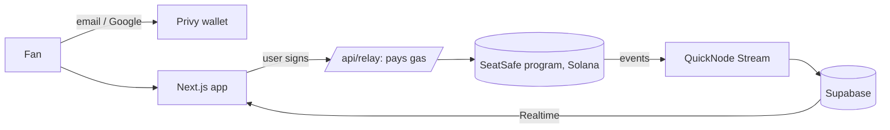

# SeatSafe

**Buy and resell tickets without getting scammed or price-gouged.** Your money only moves when the ticket does: SeatSafe tickets live on Solana with a resale price cap enforced in code, fan resales are atomic swaps, and tickets from other platforms are sold through an escrow vault that refunds the buyer automatically if the seller never delivers. Fans never see crypto: email login, prices in dollars, no gas.

- **Live app:** https://seat-safe-chi.vercel.app
- **Demo video (3 min):** TODO(C)
- **Program (Solana devnet):** [`7fnVUPd18tDr2CbEgjTxt55Emq4CMMskR9qxprjQjypy`](https://explorer.solana.com/address/7fnVUPd18tDr2CbEgjTxt55Emq4CMMskR9qxprjQjypy?cluster=devnet)
- **Track:** Consumer Applications · **Chain award:** Best use of Solana · **Bounties:** QuickNode Streams, Grok Bot, ElevenLabs (TODO: keep only if voice is in the video)


## The problem

Global ticket fraud costs an estimated **$1.3B a year**, and **31% of 18–24-year-old gig-goers** have bought a fake ticket. At the **2026 World Cup**, fans who bought on big resale sites were left outside stadiums when their tickets never transferred ([NPR](https://www.npr.org/2026/06/26/nx-s1-5871397/world-cup-tickets-stubhub-resale-controversy)). Buyers pay before they hold anything, and scalpers resell far above face value while artists get nothing.

## What makes SeatSafe different

1. **The price cap can't be bypassed.** Most "NFT ticket" apps let the token move freely, so caps and royalties disappear the moment someone sells it elsewhere. SeatSafe tickets are **frozen Token-2022 accounts that only our program can move**, so the only way to resell is through the capped swap. A direct transfer fails (tested).
2. **It works for tickets that aren't on a blockchain.** Onchain ticketing only helps if venues adopt it. SeatSafe also protects **Ticketmaster and AXS tickets today** through an escrow vault, so fans are safe from day one, before any artist signs up.
3. **It protects both sides, without trusting us.** Seller never delivers → buyer refunded. Buyer goes silent → seller paid. These are deadlines **anyone can trigger** on Solana, and no admin can withdraw user funds.
4. **Proof, not promises.** `/verify/<address>` and our Grok concierge check a listing **on the blockchain** before you pay. A scam site can copy our design; it can't fake an account owned by our program.
5. **Crypto is genuinely invisible.** Email login, embedded wallet, dollars on screen, **users hold 0 SOL** (a relayer pays gas), and **Solana Pay** for in-person sales at the gate.

## Features

| | |
| --- | --- |
| **3D stadium** | Hover stands for prices, glide in, see the real view from your seat, buy |
| **Fair resale** | Above the artist's cap: blocked by the program. At or below: one-transaction swap with an artist royalty |
| **Escrow for outside tickets** | Money waits in a vault; automatic refund if the seller never delivers |
| **Sell in person** | Solana Pay QR at the gate; the buyer scans and the swap happens instantly |
| **Live updates** | Order tracker, notifications and a protection ticker, pushed from onchain events |
| **Verify, calendar, gate pass, agents** | Check any listing; add events to your calendar; rotating-QR gate pass; standing orders filled from a capped budget |
| **Live Lab** | [/simulator](https://seat-safe-chi.vercel.app/simulator): watch two people trade a ticket on devnet with every layer shown |

## How we use Solana

- **Anchor program** `seatsafe` on devnet ([`7fnVUPd18…Qjypy`](https://explorer.solana.com/address/7fnVUPd18tDr2CbEgjTxt55Emq4CMMskR9qxprjQjypy?cluster=devnet)).
- **Token Extensions:** one Token-2022 mint per ticket with **DefaultAccountState = Frozen**; mint and freeze authority is a program PDA, so only the program can move tickets.
- **Atomic swap:** `swap_resale` moves the ticket and splits the USDC between seller, artist royalty and the 3% fee in one instruction; `list_resale` enforces `price ≤ resale_cap`.
- **Escrow vaults:** each order's PDA owns its USDC vault; `refund_expired` / `release_expired` are permissionless after the onchain deadline.
- **Gasless:** a relayer is fee payer and rent payer; users sign with a Privy embedded Solana wallet.
- **Solana Pay:** a transaction-request endpoint (`/api/pay/swap`) returns the swap with the relayer as fee payer; the buyer scans and signs.
- **USDC:** Circle devnet USDC `4zMMC9srt5Ri5X14GAgXhaHii3GnPAEERYPJgZJDncDU`.

Full program reference, economics and risk assumptions: [docs/program.md](docs/program.md). All addresses: [docs/deployment.md](docs/deployment.md).

## Architecture



## QuickNode Streams

- **Network:** Solana devnet · **Dataset:** Block
- **Filter:** `main(stream)` keeps only transactions whose logs mention our program ID ([code](docs/backend.md))
- **Destination:** webhook `https://seat-safe-chi.vercel.app/api/stream-webhook` (secret header)
- **Why:** it's the core data source for everything live: the webhook decodes our Anchor events into Supabase, and Realtime pushes them to the order tracker, buyer/seller notifications and the protection ticker within seconds, with no polling.

## Grok Bot on X

Grok is SeatSafe's trust checker and concierge on X. Given a listing's onchain account data, Grok confirms whether the SeatSafe program controls the money or the address is fake ("do not send any money"), in plain English. It walks fans who can't attend through a capped resale with a one-tap link, answers "just Venmo me" offers, and creates calendar reminders. Asked to trust our new website on its own, Grok refused, which is exactly why SeatSafe's proof comes from the blockchain. [Chat export](docs/grok-chat-export.md).

## ElevenLabs

We use **ElevenLabs Agents** via the React SDK for voice approval: when the agent finds tickets above the approval threshold, it calls the fan, reads out seat, price and seller, and a spoken "yes" triggers the onchain purchase (`app/components/VoiceApproval.tsx`).

## Run it

```bash
cd app && npm install && npm run dev        # mock data, no keys needed
cd program && npm install && npm test       # 24 program tests
```

Devnet setup, environment variables and demo data: [docs/deployment.md](docs/deployment.md).

Built for University Blockchain Conference 🫶🏼
