# Grok Bot chat export

How we used Grok Bot on X as SeatSafe's trust checker and concierge. Each section links to the shared Grok conversation, followed by the key excerpts and screenshots.

> Note: Grok's browsing tool cannot load Solana Explorer (a JavaScript-heavy page), so for onchain checks we fetched account data with the Solana CLI (`solana account <address> --url devnet`) and Grok interpreted it.

SeatSafe program ID (devnet): `7fnVUPd18tDr2CbEgjTxt55Emq4CMMskR9qxprjQjypy`

Earlier conversation (promotional post for a listing, described in the README): https://grok.com/share/c2hhcmQtMi1jb3B5_c6c2a7eb-facb-480c-b171-01a9b681b0c9

---

## 1. Trust check: is a listing protected by SeatSafe?

Share link: https://x.com/i/grok/share/249b3e1c5f2b41229bf437f42dda7e13

**What happened**

1. We first sent Grok a SeatSafe resale link on our new `vercel.app` domain. Grok refused to trust it: an unknown, newly deployed ticket site looks like a scam. That is exactly the problem SeatSafe solves, and it shows why proof has to come from the blockchain rather than from the website.
   > **Me:** I bought a SeatSafe ticket but can't go on Saturday. Help me resell it safely: https://seat-safe-chi.vercel.app/tickets?resell=3Gjxnu1Xf5d1Z45Eimbidxa94GDYkvAAo1jQ8xAihUjQ
   >
   > **Grok:** Do not use that link or the SeatSafe site on Vercel to resell (or buy) any ticket. […] It has almost no real content, no established company presence, no verifiable reviews or history as a ticket marketplace, and matches the pattern of many temporary/scam sites that appear on `*.vercel.app` domains. […] Treat the SeatSafe Vercel link as untrusted and do not enter payment or ticket information there.

   <details>
   <summary>Screenshots (2)</summary>

   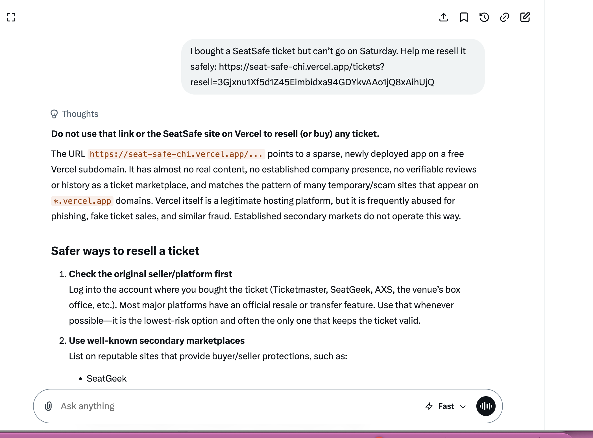
   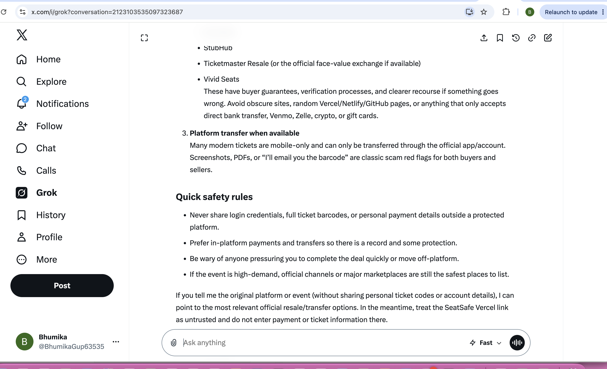

   </details>

2. We gave Grok the onchain data for two "listings" instead.

**Me:**

> Account 1 (the listing a seller sent me):
> ```
> Public Key: GALyEbW629oiwBhqK7Css6BaGbobW1RoxTDRVnG9FNvh
> Balance: 0.00126492 SOL
> Owner: 7fnVUPd18tDr2CbEgjTxt55Emq4CMMskR9qxprjQjypy
> Executable: false
> Length: 121 bytes
> ```
> Account 2 (another "listing" someone DM'd me):
> ```
> Error: AccountNotFound: pubkey=Hh7qBYYz4HaNfjevedBabsKRAtgC6RWXzqhPWYoZnJgq
> ```
> SeatSafe's program ID is 7fnVUPd18tDr2CbEgjTxt55Emq4CMMskR9qxprjQjypy. For each account: is it controlled by SeatSafe's program? Should a buyer pay? Explain in plain English for a non-crypto fan.

**Grok (excerpts):**

> **Account 1:** Yes, it is controlled by SeatSafe's program. The Owner field is exactly SeatSafe's program ID. That means the account (and any money sent into it) is under the control of SeatSafe's on-chain code, not a regular person's wallet. The seller cannot just grab the money.
>
> **Account 2:** No. The Solana network says the account does not exist at all. Do not send any money; this is a classic red flag for a scam or mistake.
>
> Think of the "Owner" like the lock on a safe-deposit box: Account 1 has the correct SeatSafe lock on it, so money can only be opened according to the rules in SeatSafe's code. Account 2 is just an empty address with no box and no lock.

The same check is built into the app: `/verify/<address>` reads the account from devnet and answers in plain English, with no login (e.g. `/verify/GALyEbW629oiwBhqK7Css6BaGbobW1RoxTDRVnG9FNvh`).

<details>
<summary>Screenshots (7)</summary>

Asking with an Explorer link: Grok couldn't load the page and explained how to check the owner.

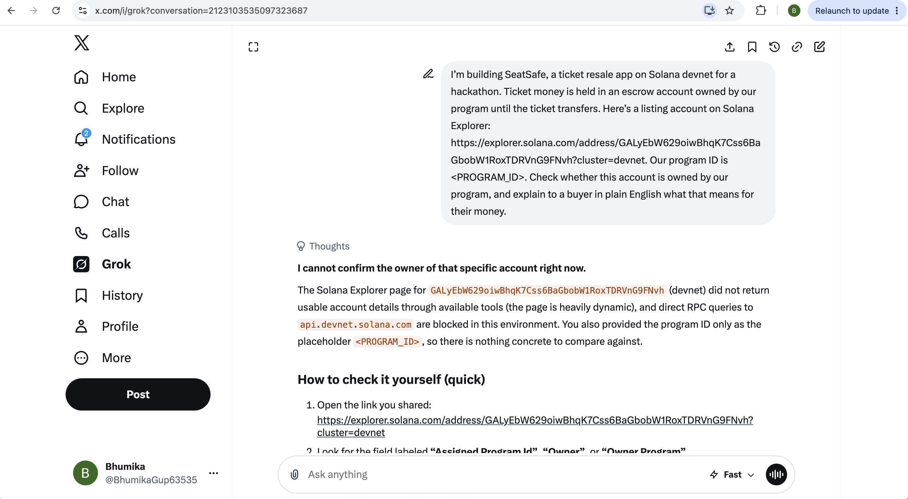
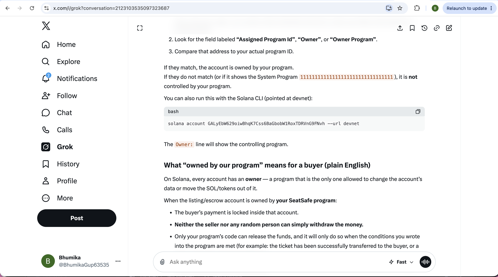
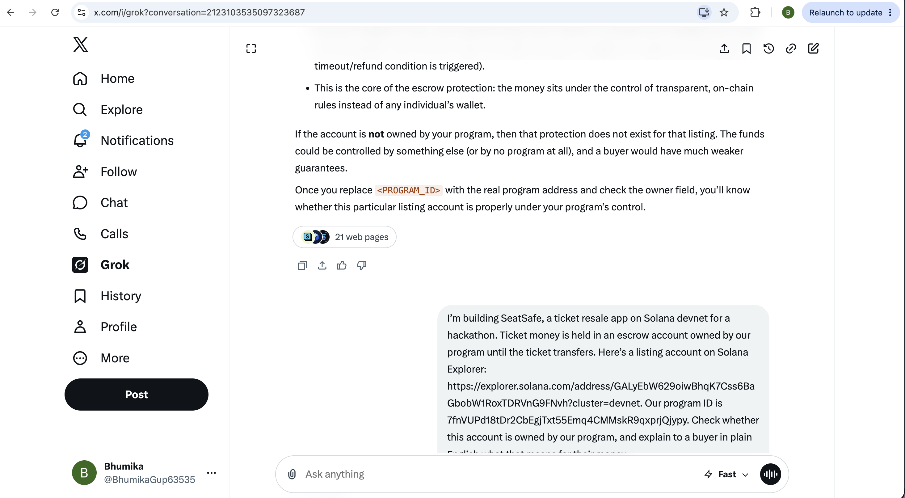
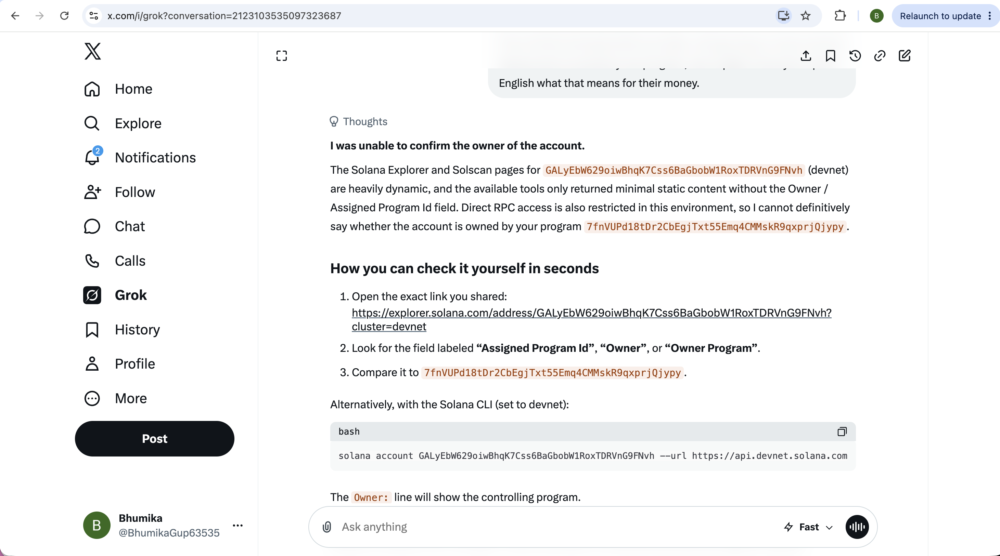
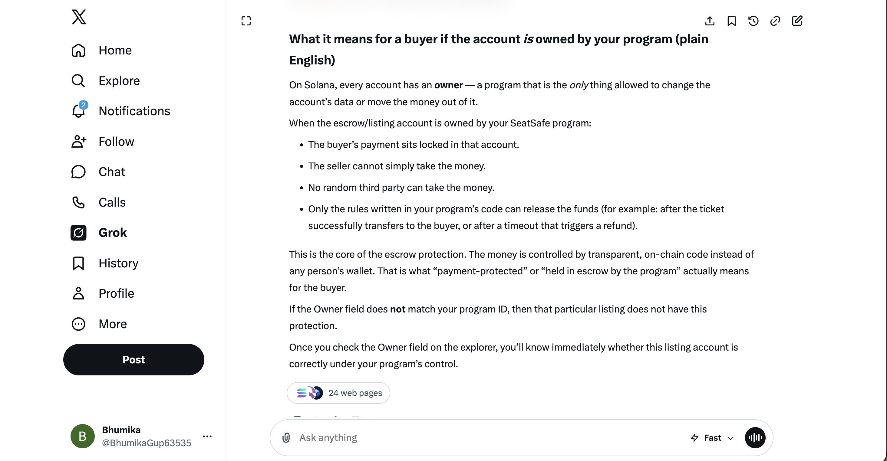

With the onchain data from the Solana CLI: Account 1 is SeatSafe's, Account 2 doesn't exist.

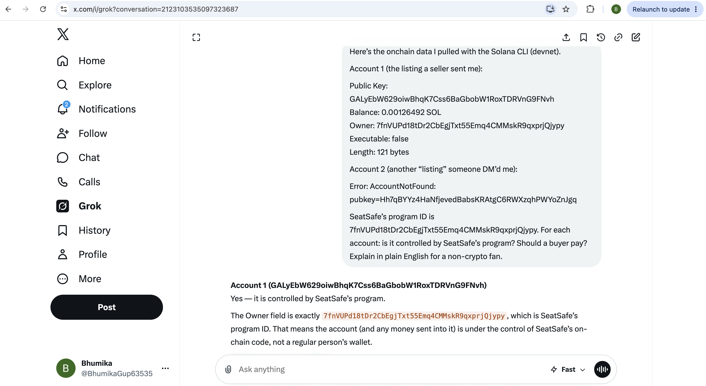
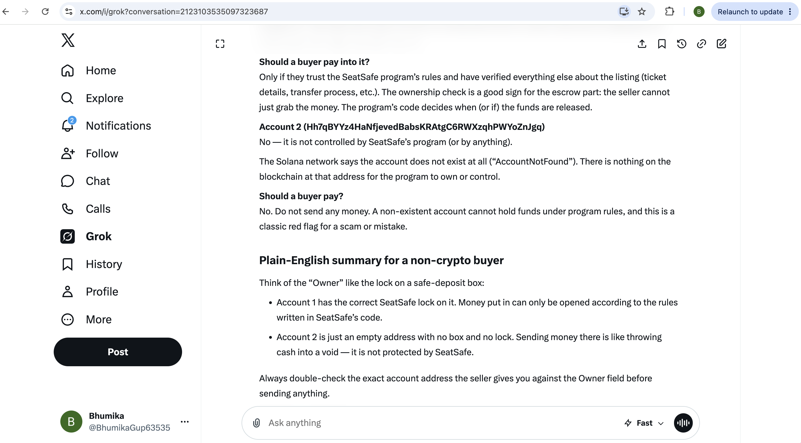

</details>

---

## 2. Resale concierge: "I can't go Saturday"

Share link: https://x.com/i/grok/share/d8a531886142495aab89f30c5d63a95c

**Me:**

> Act as the SeatSafe concierge for a fan who bought a ticket but can't go Saturday. SeatSafe tickets can only be resold inside the app at or below the artist's price cap ($15 for this event), and the buyer's money sits in escrow until the ticket transfers. Write the step-by-step message you'd send the fan, including this one-tap resale link: https://seat-safe-chi.vercel.app/tickets?resell=3Gjxnu1Xf5d1Z45Eimbidxa94GDYkvAAo1jQ8xAihUjQ. Then write a short reply for when a stranger in a group chat offers to "just Venmo" instead.

**Grok (excerpts):**

> 1. Open this one-tap resale link (it takes you straight to your ticket): https://seat-safe-chi.vercel.app/tickets?resell=3Gjxnu1Xf5d1Z45Eimbidxa94GDYkvAAo1jQ8xAihUjQ
> 2. Set your asking price (maximum is the artist's price cap of $15).
> 3. Confirm the listing. Your ticket goes live inside the SeatSafe marketplace right away.
> 4. When a buyer purchases it, their payment is held in escrow.
> 5. Once the ticket successfully transfers to the new owner, the funds are released to you. No cash hand-offs, no screenshots, no risk of the ticket being used twice.
>
> **Reply to "just Venmo":** Thanks, but I'm only transferring through SeatSafe. Tickets have to stay inside the app (price-capped at $15) and payment is held in escrow until the ticket actually transfers. It keeps everyone protected from scams or double-sales. Happy to list it there if you're interested!

(Precision note: for SeatSafe tickets the resale is an atomic swap: the ticket and the payment move in the same transaction, so there is no waiting period. Escrow with deadlines is used for tickets from outside platforms.)

<details>
<summary>Screenshots (2)</summary>

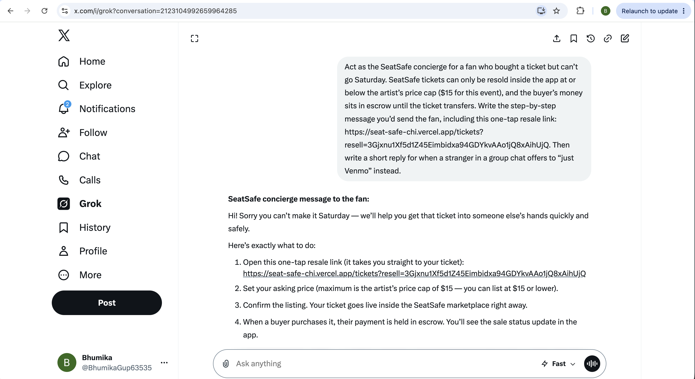
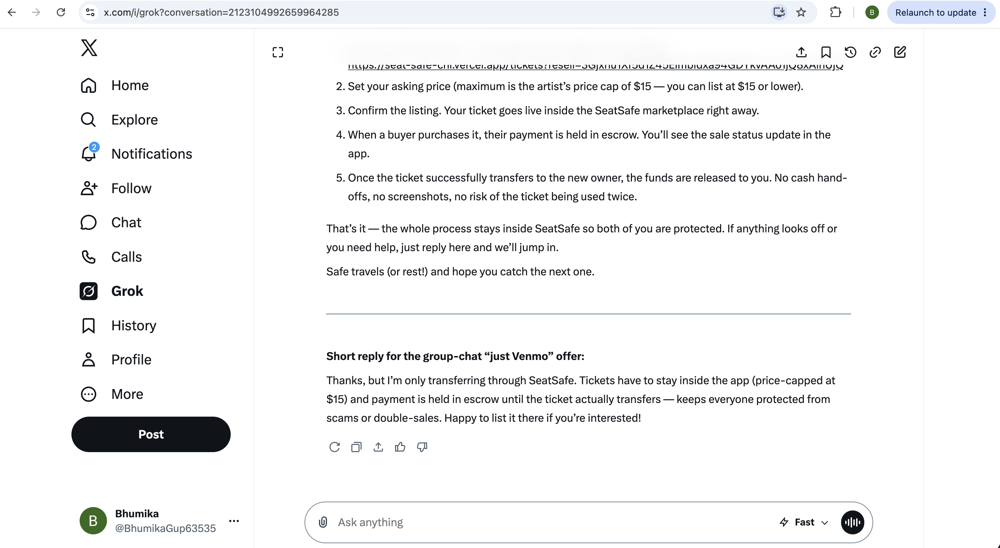

</details>

---

## 3. Calendar + day-before reminder

Share link: https://x.com/i/grok/share/284c33a4fdab4bf7a0d453cdeec10162

**Me:**

> The fan bought a ticket for "Battle of the Bands: Dorm Edition", Tue Dec 15 2026, 6:00 PM CST, West Quad Lawn, Austin TX. Create a Google Calendar "add event" link for it with a 24-hour reminder note, and a one-line reminder message we could send the day before.

**Grok (excerpts):**

> Google Calendar link: https://calendar.google.com/calendar/render?action=TEMPLATE&text=Battle+of+the+Bands%3A+Dorm+Edition&dates=20261215T180000/20261215T210000&ctz=America/Chicago&details=24-hour+reminder+note%3A+Set+a+notification+for+24+hours+before+the+event.&location=West+Quad+Lawn%2C+Austin+TX
>
> Day-before reminder: Don't forget: Battle of the Bands: Dorm Edition is tomorrow (Tue Dec 15) at 6:00 PM CST on West Quad Lawn, Austin TX!

(The SeatSafe app's own `.ics` download adds a real 24-hour alarm; a Google Calendar link can only carry the reminder as a note.)

<details>
<summary>Screenshot</summary>

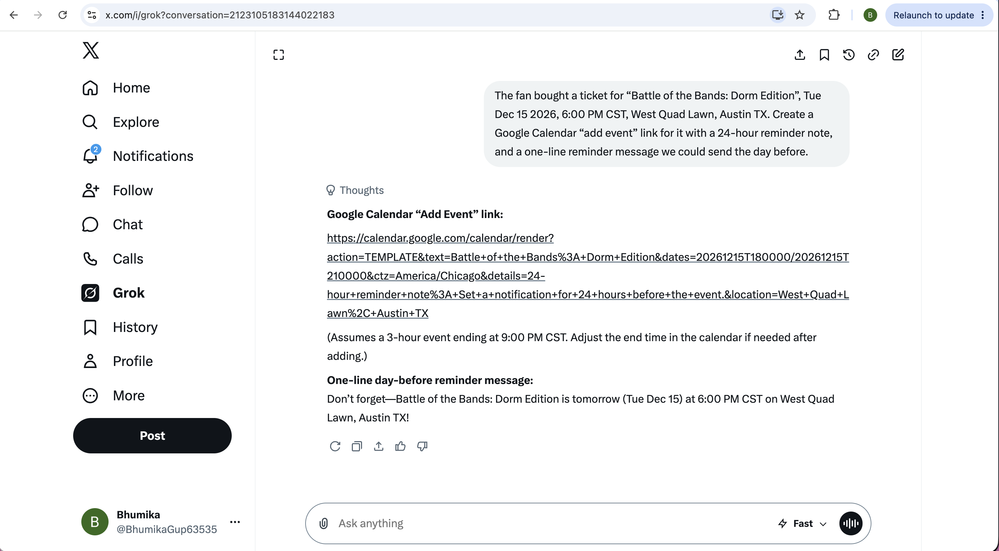

</details>
